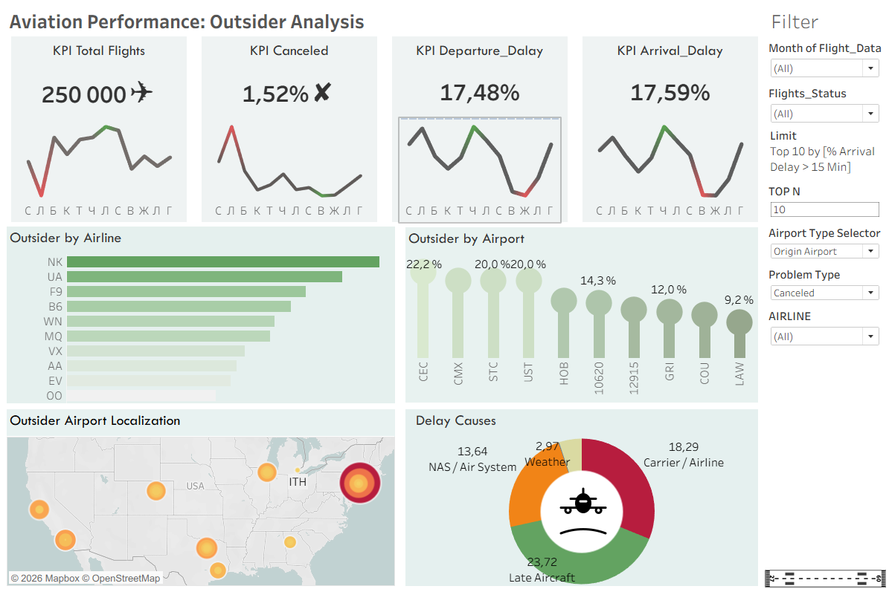

# Aviation Performance: Outsider Analysis (Tableau Dashboard)

An interactive Tableau analytics dashboard analyzing flight delays, cancellations, airport bottlenecks, and underlying delay causes across major US airlines.

---

## 📊 Project Overview

This Tableau project addresses key operational metrics in aviation:
- **Total Flights & Cancellations:** Overview of total volume (250K flights) and overall cancellation rate (1,52%).
- **Delay KPIs:** Departure delay rate (17,48%) vs. Arrival delay rate (17,59%).
- **Outsider Identification:** Ranking airlines and airports with the highest arrival/departure delays.
- **Geographic Bottlenecks:** Spatial analysis mapping airports with critical delay levels.
- **Root Cause Analysis:** Breakdown of delays by Carrier, Late Aircraft, NAS/Air System, and Weather.

---

## 🖼 Dashboard Screenshot

---

## 🛠 Key Features & Tableau Functionality

- **Dynamic Selectors:** Filters for Flight Date, Status, Top N ranking, Airport Type, and Problem Type.
- **Geographic Mapping:** Interactive Mapbox integration showing geographical distribution of delay hotspots.
- **Custom KPIs & Sparklines:** Monthly trend lines tracking performance spikes and seasonal fluctuations.
- **Cause Breakdown:** Donut chart highlighting *Late Aircraft (23.72%)* and *Carrier/Airline (18.29%)* as primary drivers.

---

## 📂 Project Structure

---

## 🚀 How to View

1. Download `Project Final.twbx` from this repository.
2. Open using **Tableau Desktop** or **Tableau Reader**.
3. *(Optional)* View the interactive version directly via Tableau Public (if published).
